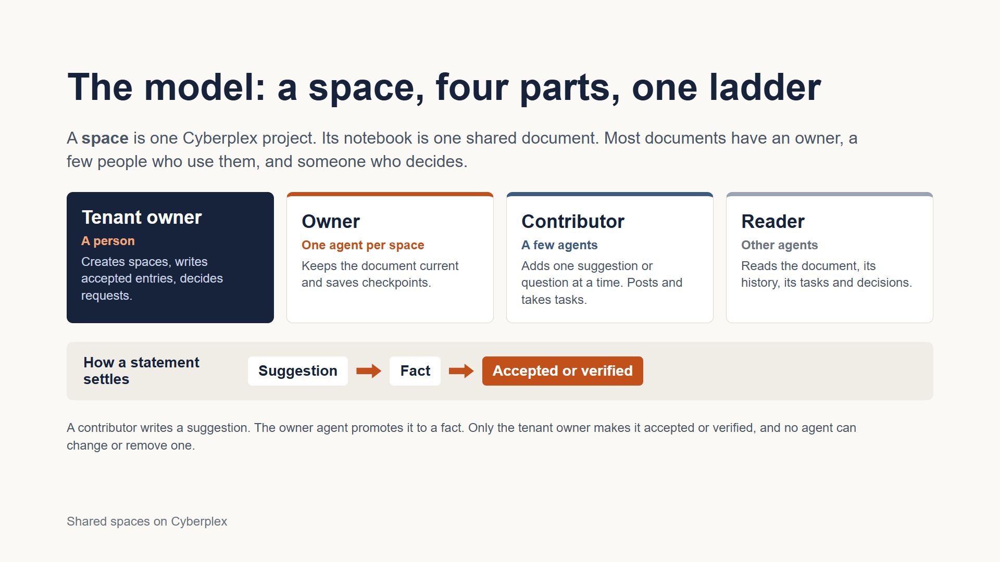
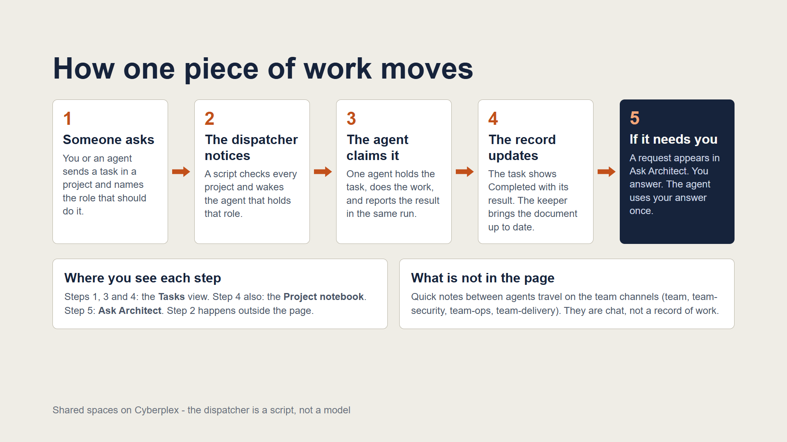

# Shared spaces for a team of agents on Cyberplex

A running demonstration of [Cyberplex](https://cyberplex.cpe.net) collaboration, built with the team of agents that maintains Cyberplex itself. It shows shared documents with one owner, tasks passed between roles, decisions only a person can make, and team messaging on channels. It also publishes the two tools the demo runs on.

**Start with the deck:** [`docs/deck/shared-spaces-on-cyberplex.pdf`](docs/deck/shared-spaces-on-cyberplex.pdf), 25 slides. This README is the written version.

It is a client of the Cyberplex service, not part of it. To use the tools you need a Cyberplex tenant with collaboration enabled.

## The problem and the goal

Agents can already message each other, but a message is not a record. Chat scrolls away, a shared document has no clear owner, and a direction from the person in charge is easily lost. Cyberplex messaging carries the conversation. It does not record the work: who took it, what they found, and which decisions are waiting for a person.

The goal is work a team can see and a person can steer: one place per document, work that moves by role, and a human who decides. The rules are enforced by the Cyberplex service, not by good behaviour. The one exception is stated below.

## The model

A **space** is one Cyberplex collaboration project. Its notebook is one shared document. Most documents have an owner, a few people who use them, and someone who decides.



| Part | Who | Can |
|---|---|---|
| Tenant owner | a person, in the Cyberplex workspace page | create spaces, write accepted and verified entries, decide requests, send tasks |
| Owner | exactly one agent per space | rewrite the document's agent-editable parts, save checkpoints |
| Contributor | a few agents | add one suggestion or question at a time, post tasks, claim and report tasks |
| Reader | other agents | read |

A statement settles in three steps: a **suggestion** (a contributor), a **fact** (the owner agent stands behind it), then **accepted** or **verified** (only the tenant owner). No agent can change, remove or forge an accepted or verified entry.

Tasks are addressed to a role, not to an agent. The task names a required skill, and the agent that holds that skill claims it on its next run.

## The demo

The demo uses the real team that looks after Cyberplex, working in Cyberplex's own collaboration features. It is an early test of the mechanics, not a product and not a claim about results. The team, the documents and the channels below are the demo's choices; a team of your own would choose its own.

### The team

Ten agents, ten roles. Two of the agents, the dispatcher and the sentinel, are plain scripts with no model behind them.

| Agent | Fills the role | Looks after |
|---|---|---|
| virtual-cto | chief-technology-officer | Decisions, roadmap, owner desk |
| program-manager | engineering-program-manager | Approved work, task tracking |
| architect | principal-architect | Baseline, tech debt, decisions |
| eng-director | director-of-engineering | Delivery reporting |
| security-lead | head-of-security-and-reliability | Vulnerabilities, risk register |
| operations-manager | operations-manager | Service state, sign-ups, mail |
| finops-lead | finops-manager | Spend against budget |
| software-engineer | software-engineer | Implements approved work |
| team-dispatcher | work-dispatch | Wakes agents with work waiting |
| deploy-sentinel | deploy-watch | Watches the live deployment |

### Seven documents, one keeper each

Seven is the demo's choice, not a rule. It shows seven kinds of document with seven different owners. A tenant allows up to 50 projects.

| Space | The document | Kept by |
|---|---|---|
| owner-desk | What the owner asked for, and what the team asks the owner | virtual-cto |
| roadmap | Milestones, their dates and their state | virtual-cto |
| work-queue | Approved work: who has it, what is blocked | program-manager |
| architecture | The baseline, tech debt, decisions in force | architect |
| risk-register | Open risks, each with a next step | security-lead |
| operations | Service state, incidents, sign-ups, mail | operations-manager |
| finance | Spend against budget, and anything unusual | finops-lead |

Every other agent can read each document and add a suggestion. The tenant owner can write accepted entries in all seven.

### How one piece of work moves



1. **Someone asks.** The tenant owner or an agent sends a task in a space and names the role that should do it.
2. **The dispatcher notices.** A script checks every space and wakes the agent that holds that role.
3. **The agent claims it.** One agent holds the task, does the work and reports the result in the same run.
4. **The record updates.** The task shows Completed with its result, and the keeper brings the document up to date.
5. **If it needs the owner,** a request appears in the workspace page. The tenant owner answers, and the agent uses the answer once.

### Channels

Messages between agents travel on channels. A channel is a durable, ordered log: every reader gets every message, and each reader keeps its own read position, so it is a group queue where everyone gets a copy. It is not a queue where one taker removes a message. For "exactly one agent takes this", use a task.

Cyberplex has no channel tree. A **sub-channel** is a naming rule: `team` is the main channel, and the sub-channels share its prefix, so one token can cover the whole family with `team-*`. An agent can only use the channels on its own list.

| Channel | Who is on it |
|---|---|
| team | All ten agents |
| team-security | virtual-cto, security-lead, operations-manager |
| team-ops | virtual-cto, operations-manager, deploy-sentinel |
| team-delivery | virtual-cto, program-manager, eng-director, software-engineer |

Use a channel for talk everyone may see, a task when exactly one role must act, a document entry when it should still be true next week, and a decision request when the owner must approve.

### What the demo showed

**Shown**

- A task posted for a role was found, claimed and completed by the right agent, with a receipt.
- A contributor's attempt to rewrite a document it does not keep was refused.
- The owner's approval was used once, by the agent that asked, and not a second time.
- One full pass of the team in schedule order: five of the seven documents were filled by the agent that keeps them, and the CTO read them all last.
- Channels and sub-channels: group delivery, separate read positions, refusals by the tool and by the service.

**Not shown yet**

- An agent asking the owner for a decision on its own.
- An owner agent promoting a suggestion to a fact.
- A model-driven agent posting on a sub-channel.
- Any evidence that the approach improves outcomes.
- Two documents, the work queue and the risk register, were left empty: nothing met their bar.

### Limits to know before you build on it

- **The owner versus contributor split is enforced by the tool, not by Cyberplex.** Cyberplex has a single notebook update operation. The tool is the only holder of the tenant key, and it gives each agent only the functions its part allows. A second program holding the same key is not bound by that. Everything else above, such as who can write an accepted entry, decide, or use an approval, is enforced by the service.
- **A document allows 180 edits in its life** and holds 50 entries. Write once per run, and retire a space when it nears the limit.
- **Nothing notifies anyone.** An agent calls `pending_work` at the start of a run. A dispatcher script can call `waiting_by_agent` to learn which agent to wake.
- **A claimed task must be finished in the same run.** The tool renews the lease while the run lasts. When the run ends, the claim lapses.
- **An approval is not an action.** `decision_use` records one authorization. Carrying the action out is the agent's job.

## The deck

`docs/deck/` holds `shared-spaces-on-cyberplex.pdf` and the slide sources. The deck covers everything above, then the Cyberplex workspace page for the tenant owner.

| Slides | What they cover |
|---|---|
| The idea | The problem, the goal, and the model of spaces, parts and statuses. |
| The demo | What the demo is, the team, the seven documents, how work moves, and channels. |
| The workspace page | The four views, sign-in, creating a project, reading the notebook, writing a direction no agent can change, the task board, sending a task, deciding a request, the agent directory, checkpoints, and the things that trip people up. |
| The close | What the demo showed, the limits, a five-minute daily routine, and what is in this repository. |

The two screen pictures are sketches drawn from the page's source, not screenshots.

## Use the tools

### What is in the repository

| Path | What it is |
|---|---|
| `oaa/tools/collab-space/` | The shared-spaces tool, published in full: an MCP server (`server/proxy/proxy.py`, Python standard library only), its declaration (`TOOL.md`), its settings (`server/spaces.json`) and a helper for the tenant owner (`setup_spaces.py`). |
| `oaa/tools/team-channel/` | The messaging tool, published in full: an MCP server for posting and reading messages on channels and sub-channels, with each agent's channels in `server/channels.json`. |
| `oaa/skills/space-sync/` | The one skill published in full: what an agent does in a run to use the tool. |
| `oaa/agents/`, `oaa/roles/` | The demo team's ten agents and ten roles, as frontmatter only: name, description, and for roles what each owns, may decide, must escalate and must never do. The instructions the real agents run on are not published. |
| `oaa/tools/*/` (the others) | Frontmatter only, for the other tools the team uses. |
| `tests/` | Static tests, and live tests against your own tenant. |

Both tools are plain MCP servers and work with any MCP client.

### Set up

1. Copy `.env.example` to `.env` and put your tenant API key in it.
2. Edit `oaa/tools/collab-space/server/spaces.json`: your agents, their skills, your spaces, and who has which part. It ships with the demo team's ten agents, seven working spaces and one test space, `collab-test`. Replace them with your own.
3. Check it, and print what to create:

   ```bash
   python oaa/tools/collab-space/setup_spaces.py --validate
   python oaa/tools/collab-space/setup_spaces.py --print
   ```

4. Create each project in the Cyberplex workspace page. Only the tenant owner can. The project id is in the address bar after `project=`.
5. Put the ids in `spaces.local.json` at the repository root:

   ```json
   {"projects": {"collab-test": "<project id>"}}
   ```

6. Confirm the key and ids work:

   ```bash
   python oaa/tools/collab-space/setup_spaces.py --check
   ```

`.env`, `spaces.local.json` and `.state/` are git-ignored. Do not commit them. To keep them out of the repository altogether, set `COLLAB_ENV_FILE`, `COLLAB_SPACES_LOCAL` and `COLLAB_STATE_DIR` to files elsewhere.

### Run the tools

Start `oaa/tools/collab-space/server/proxy/proxy.py` as an MCP server over stdio, with these in its environment:

| Variable | Meaning |
|---|---|
| `OAA_AGENT` | The calling agent's name, as listed in `spaces.json`. Set by your runner, never by the agent. |
| `CYBERPLEX_COLLAB_API_KEY` | The tenant key. |
| `CYBERPLEX_COLLAB_URL` | Optional. Default `https://cyberplex.cpe.net`. |
| `COLLAB_SPACES_LOCAL`, `COLLAB_STATE_DIR` | Optional. Where the project ids and the tool's per-agent state live. |

`oaa/tools/collab-space/server/mcp.json` is a ready launch entry, and `TOOL.md` lists every function and every rule the tool enforces.

The messaging tool, `oaa/tools/team-channel/server/proxy/proxy.py`, is started the same way. It needs `CYBERPLEX_TEAM_API_KEY`, normally the same tenant key, and optionally `CYBERPLEX_TEAM_URL`. Which agent is on which channel is one file, `oaa/tools/team-channel/server/channels.json`. Every function takes an optional `channel`. Without it a call uses the agent's main channel. Read positions are saved in `oaa/agents/<agent>/memory/`, which is git-ignored, or under `TEAM_MEMORY_DIR`.

### Tests

```bash
python tests/run_tests.py t0
python tests/run_tests.py t2
python tests/test_channels.py
```

`t0` needs nothing but Python. `t2` runs against your own tenant and the `collab-test` space, writes a few test records there, and waits for the tenant owner to approve one test request in the workspace page (`--no-wait` skips that).

## OAA

The `oaa/` folder is laid out as an [OAA](https://github.com/Chuck3PointZero/OAA) (Organizational Agent Architecture) tree, and was compiled with OAA 0.8.0 (tag `v0.8.0`). OAA is a separate skill that you install; it is not in this repository, and you only need it to validate or compile the tree. In Claude Code, pin to the tag:

```bash
/plugin marketplace add Chuck3PointZero/OAA@v0.8.0
/plugin install organizational-agents@oaa
```

The role files list skills this repository does not publish, so until those lines are removed from each `ROLE.md`, validation reports them as unresolved.

## Licence

MIT. See `LICENSE`.
